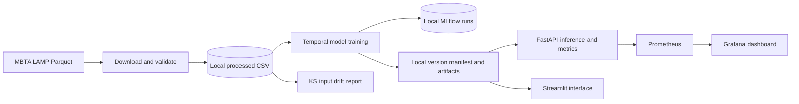

# PulseRoute AI

An end-to-end, local-first MLOps learning project for MBTA subway stop delay risk. It includes real-data acquisition, time-based evaluation, MLflow experiments, a local model lifecycle manifest, drift checks, a FastAPI service, Streamlit UI, container and local Kubernetes configuration, CI, Prometheus, Grafana, and provider-free Terraform configuration.

## Dataset and target

The project uses the MBTA LAMP Subway Performance Data, published as one Parquet partition per service date. MBTA describes each row as a `trip_id`/`stop_id` pair, and documents `scheduled_arrival_time` as GTFS schedule data and `stop_timestamp` as the observed GTFS-Realtime arrival timestamp (or fallback stop update). We label a record late when actual arrival is more than five minutes after its scheduled arrival. See the [MBTA LAMP data portal](https://performancedata.mbta.com/) and [data dictionary](https://github.com/mbta/lamp/blob/main/Data_Dictionary.md).

The acquisition script reads MBTA's published service-date index and downloads the latest 30 available partitions by default (`python scripts/pr_cli.py acquire --days 90` requests a wider window). Raw downloads and index are kept below `data/raw`; the model table is written to `data/processed`. Data are not committed. This is stop-level subway performance, not bus journey ground truth. It has no observed weather or passenger load. The published performance data are computed from real-time feeds, so coverage and matching failures can bias observed trips. Use is governed by the [MassDOT Developers License Agreement](https://www.mass.gov/doc/developers-license-agreement-11132009/download); review and accept the terms before acquiring or redistributing data. Delay duration is retained for analysis but regression is omitted because this application predicts a binary classification target.

If network access prevents MBTA acquisition, create an explicitly synthetic dataset for local software development with `python scripts/pr_cli.py demo-data`. Its metadata says `SYNTHETIC_DEVELOPMENT_FALLBACK`. Those generated rows are not transit records and model scores on them are not real-world evidence. Use `acquire` again when network access is available.

Features are restricted to route, direction, stop sequence, scheduled hour, weekday, and month. The label uses actual arrival and is excluded from training features. Evaluation uses an 80/20 chronological split. The current model estimates whether an arrival is more than five minutes late based on schedule context; it does not have live traffic, prior-stop observations, or weather inputs.

## Architecture



## Windows PowerShell setup

```powershell
cd pulse-route-ai
python -m venv .venv
.\.venv\Scripts\Activate.ps1
python -m pip install --upgrade pip
Copy-Item .env.example .env
pip install -e ".[dev]"
```

Python 3.10+ is declared in packaging; CI and the container use Python 3.11, and this workspace verification used Python 3.13.5. For offline UI/API smoke tests, dependencies must already be installed; dataset acquisition requires internet access.

## Data, training, and MLflow

```powershell
python scripts/pr_cli.py acquire
python scripts/pr_cli.py validate
python scripts/pr_cli.py train
mlflow ui --backend-store-uri sqlite:///./mlflow.db --host 127.0.0.1 --port 5000
```

Training compares a prior majority classifier, balanced Logistic Regression, Random Forest, and histogram gradient boosting. Preprocessing and model are fitted together in a scikit-learn pipeline. Metrics include precision, recall, F1, ROC-AUC where both classes exist, accuracy, and confusion matrix. The selected candidate is saved as `artifacts/candidate.joblib`; an evaluation report and `registry.json` record the version and checksum. Runs use a local SQLite MLflow tracking (`mlflow.db`) by default. To use a remote MLflow server, set `MLFLOW_TRACKING_URI` to its URI; external artifact storage/server configuration is the operator's responsibility.

The local JSON registry manifest is intentionally not described as MLflow Model Registry. Promotion requires a manual command (`python scripts/pr_cli.py promote`) and rollback selects the most recently archived champion (`python scripts/pr_cli.py rollback`). Promotion compares candidate and champion F1 and rejects a lower-scoring candidate; the first candidate requires explicit operator approval through the command. The demo workflow records lifecycle history. In a production deployment add policy thresholds for other metrics and concurrent-write locking.

## Drift and retraining

```powershell
$env:PULSEROUTE_REFERENCE = "data/processed/transit.csv"
$env:PULSEROUTE_CURRENT = "data/processed/transit.csv"
python scripts/pr_cli.py drift
```

The drift report uses two-sample Kolmogorov-Smirnov tests for numeric schedule features. A controlled demonstration shifts only a copy of the source:

```powershell
python scripts/pr_cli.py simulate-drift
```

It writes the copied input and a timestamped JSON report under `monitoring/reports`. Drift is a feature-distribution warning only. The application reports prediction drift and model degradation as unknown until separately computed from prediction and newly labelled ground truth data. Retraining is explicit: acquire, train, inspect evaluation, then promote. No automatic drift-triggered promotion occurs.

## FastAPI and Streamlit

Promote a reviewed candidate, then launch:

```powershell
python scripts/pr_cli.py promote
uvicorn pulseroute.api:app --app-dir src --reload --port 8000
streamlit run app/streamlit_app.py
```

API endpoints: `GET /health`, `GET /model`, `POST /predict`, and `GET /metrics`. Example:

```powershell
Invoke-RestMethod -Method Post -Uri http://127.0.0.1:8000/predict -ContentType 'application/json' -Body '{"route_id":"Red","direction_id":"0","stop_sequence":10,"hour":8,"day_of_week":1,"month":6}'
```

The model version in the API comes from the promoted local registry manifest. Streamlit Community Cloud deployment: push this folder to a GitHub repository and select `app/streamlit_app.py` as the entry point. After training and promotion, include the model using PowerShell: `Copy-Item artifacts\\champion.joblib app\\champion.joblib`, then set `PULSEROUTE_MODEL=app/champion.joblib` in the app settings. Check repository size and data policy before committing the model copy. This repository ignores model artifacts; no public deployment has been performed.

## Docker, monitoring, Kubernetes, Terraform

Train and promote locally before starting the API. When Docker Desktop is running:

```powershell
docker compose up --build
```

The API is at port 8000, Prometheus at 9090, and Grafana at 3000 (default local Grafana login is admin/admin; change it before sharing). Prometheus scrapes the API every 15 seconds. Dashboard panels cover requests, latency, error rate, prediction traffic, readiness, and model version. The API metrics endpoint includes HTTP counts/errors/latency, predictions, failures, readiness, and loaded model version.

For Kind, build/load the image and make the model directory available to the cluster host at `/opt/pulseroute/artifacts` before `kubectl apply -f k8s/deployment.yaml`. On Windows, that hostPath is a Linux node path and must be mounted/copied into the Kind node; use `kind load docker-image pulseroute-ai:local`. Kubernetes manifests are provided, but no cluster runtime is assumed. The deployment uses two replicas, probes, resource limits, and rolling update strategy.

Terraform has no cloud provider. Run `terraform -chdir=terraform init`, `terraform -chdir=terraform validate`, and `terraform -chdir=terraform plan`; `apply` records only the local runtime config in Terraform state. Keep Terraform state out of Git.

## CI/CD, tests, and security

GitHub Actions CI installs dependencies and runs deterministic unit tests without credentials or downloaded production data. The separate `workflow_dispatch` image workflow uses GHCR and the `release-approval` GitHub environment; configure that environment's required reviewer and repository permissions before use. Publishing does not run on ordinary pushes. No cloud resources are provisioned.

Run tests with `pytest -q`. Never expose real passenger identifiers (the model table removes trip and vehicle IDs), credentials, local MLflow runs, data, or trained artifacts. The API is an educational demo: add authentication, TLS, stricter request limits, registry integrity enforcement, and a secured secret store before deployment beyond localhost. There is no external paid API or cloud requirement. Data fetch needs internet; Docker needs Docker Engine; Kubernetes commands need a local Kind/Minikube cluster; Terraform local validation needs Terraform binary.

## Troubleshooting

- If acquisition returns a schema mismatch or an MBTA partition is unavailable, inspect `data/raw/index.csv` and the LAMP data dictionary; MBTA notes exports may change.
- If training finds a single class in a temporal holdout, acquire additional service dates or change the documented observation window after inspecting class distribution.
- If health reports `model_unavailable`, train and explicitly promote a candidate.
- If Compose cannot start, verify Docker Desktop is running and ports 3000, 8000, and 9090 are free.
